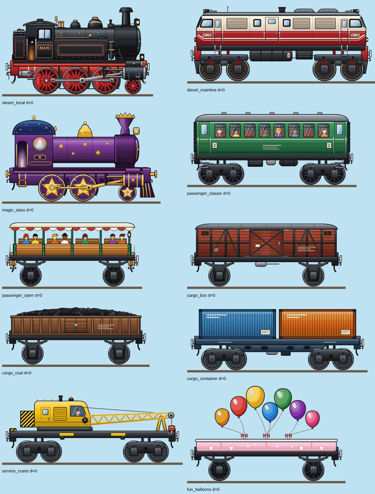
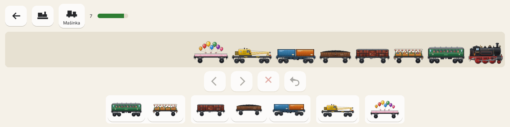
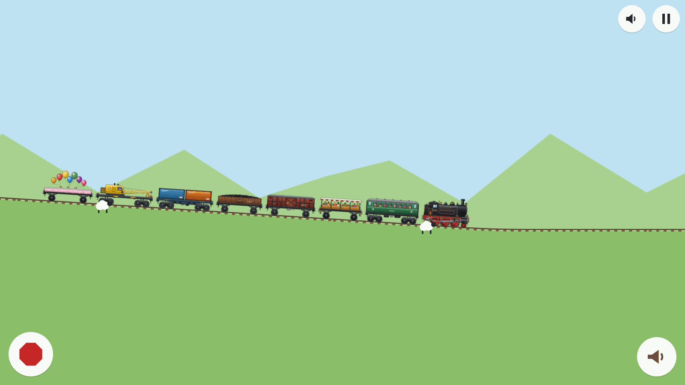

# Ověření iterace „Úpravy první verze“ (dokument 14)

Průběžný protokol iterace podle [zadání 14](../../vlacek-predavaci-balicek/14_UPRAVY_PRVNI_VERZE.md). Lokální běhy v cloudovém kontejneru: headless Chromium 156 (Playwright 1.64), softwarový WebGL bez GPU. Fyzický tablet, telefon a Tesla: **NEOVĚŘENO**.

## Výchozí stav (build `0.1.0+a9991f9`)

Obě chyby ze zadání se v sestavení potvrdily skriptovaným průchodem při DPR 1–3 (1280 × 720, 1180 × 820, 844 × 390):

- Depo kreslilo lokomotivu vlevo a vagonky přidávalo vpravo, tedy před její čelo. Jízda měla pořadí opačné.
- Kamera držela lokomotivu na 30 % šířky v pevném měřítku. Už druhý ze tří vagonků byl po Vyjet mimo obraz.
- Na telefonu na šířku byl katalog depa zalomený a tlačítko Vyjet z větší části pod okrajem.

## A — pořadí soupravy v depu (§1)

| Test                                                      | Red                                   | Green                   |
| --------------------------------------------------------- | ------------------------------------- | ----------------------- |
| E2E „the locomotive leads on the right, new wagons join…“ | FAIL: w3 vpravo od w2 (373 vs. < 252) | PASS (desktop i tablet) |
| E2E „the depot fits a phone held sideways“                | FAIL: Vyjet mimo výřez                | PASS                    |
| tamtéž, poslední karta katalogu dosažitelná               | FAIL: kartu překrývalo tlačítko Vyjet | PASS po opravě mřížky   |

Pás počítá polohy stejnou funkcí `layoutConsist` jako jízda. Ruční snímek telefonu: lokomotiva vpravo čelem doprava, vagonky doleva v pořadí výběru, katalog se posouvá, Vyjet v rohu.

## B — celý vlak v obraze a délkový limit (§2)

Rozhodnutí: [D-008](../decisions/008-whole-train-in-view.md).

| Test                                                                                             | Red                                                                         | Green   |
| ------------------------------------------------------------------------------------------------ | --------------------------------------------------------------------------- | ------- |
| Unit `ConsistEditor` „doc 14 §2: length limit“ (5 testů)                                         | 5 FAIL proti stubům (`0` místo 500, přijetí nad limit…)                     | 17 PASS |
| Unit `cameraFraming` (6 testů)                                                                   | 6 FAIL proti stubům                                                         | 6 PASS  |
| Integrace „a longer train saved by version 0.1“ (2 testy)                                        | 2 FAIL (jízda obnovena, `HOME` místo `RIDING`)                              | 20 PASS |
| Integrace „wagons stop at the length limit with a gentle signal“                                 | bez samostatného red: zapojení pravidel bylo nutné pro překlad; red je unit | PASS    |
| E2E „the depot fills to the length limit…“                                                       | proti buildu `a9991f9`: FAIL `Expected "7", Received "100 / 100"`           | PASS    |
| E2E „Vyjet shows the whole longest train…“, „…over hills and after a resize“, „…after a reload…“ | FAIL proti staré kameře: levý okraj vlaku −281 px                           | 8 PASS  |

Ruční snímky (1280 × 720, 1024 × 768, 844 × 390, nejdelší smíšená souprava s naftovou lokomotivou): celý vlak v obraze na startu i za jízdy, nad brzdou a pod tlačítky v rohu.

`PERF_SECONDS=30 npm run measure:perf` s nejdelší smíšenou soupravou (lokomotiva + 8 vagonků): všech 9 vozidel vykresleno celou dobu, nejvýše 6 živých chunků, žádné chyby. Medián **20 FPS**, p95 50 ms, nejhorší 200 ms. Verze 0.1 měla na stejném stroji 30 FPS. Výřez je teď asi dvakrát širší a v obraze jsou všechny vozy. Příčina se ověří v grafické iteraci; zatím se jen předpokládá vektorové kreslení trati v každém snímku. Jde o emulaci, ne o cílové zařízení.

Známá omezení po B:

- Ve WebGL se části některých vozů ve svahu vykreslovaly chybně; Canvas je kreslil správně. Původní podezření na `Graphics.generateTexture` se nepotvrdilo. Skutečná příčina a oprava jsou v oddílu „WebGL: zkosené vozy“ níže a v [D-010](../decisions/010-webgl-single-texture-batches.md).
- Scéna je při menším vlaku prázdnější a kopce působí velké; řeší grafická iterace a krajina (§3, §5).

## C1 — svižnější jízda (§6)

Rychlost na obrazovce je v novém měřítku `maxSpeedUPerSec × trainWidthFraction / maxConsistLengthU` šířky za sekundu, stejně na každém zařízení. Test `gameConfig` „the ride feels snappy on screen yet easy to follow“: red se 180 u/s (**0,081** šířky/s, pomaleji než 0,14 ve verzi 0.1 na 16:9), green s 480 u/s (0,216 šířky/s), rozjezd 160 u/s² (3 s), dojezd 96 u/s² (5 s), brzda 480 u/s² (1 s). Testy fyziky pohybu nově používají pevné referenční hodnoty místo laditelného výchozího nastavení; 283 unit/integračních PASS, E2E 54 PASS / 4 skipped.

## C2 — výškový profil, generátor v1 (§6)

Rozhodnutí: [D-009](../decisions/009-track-generator-v1.md).

Výchozí měření v0 stejnou metrikou (vzorky po 8 u, 64 chunků): sklon se mění na 94,5 % (svět 1), 93,7 % (77) a 91,4 % (123) délky; výška −42 až 39 u.

| Test                                                                                    | Red                                                                         | Green               |
| --------------------------------------------------------------------------------------- | --------------------------------------------------------------------------- | ------------------- |
| Unit `TrackProfile` v1 (verze, charakter, plány bloků) proti plochému stubu             | 3 FAIL (verze 0, 3 dlouhé roviny místo > 15, prázdný plán)                  | 9 PASS, pak 10 PASS |
| tamtéž GEN-04/05: 1000 světů × 100 chunků (švy výšky a sklonu, konečnost, sklon, výška) | stub vyhověl triviálně; měření v0 výše je skutečný red charakteru           | PASS                |
| „every plan segment is long enough for its transitions“ (300 světů × 20 bloků)          | doplněno při revizi vlastního kódu spolu s opravou validace proveditelnosti | PASS                |
| Integrace „a journey from track generator v0“                                           | FAIL: bez upozornění, jízda obnovena na chunku 7 nové geometrie             | PASS                |
| Validace save s `generatorVersion` 0                                                    | 13 FAIL: fixtury 0.1 hlášené jako poškozené                                 | PASS (55 unit)      |

Ruční snímky jízdy světa 123 s nejdelší soupravou: dlouhé roviny, rovná stoupání a klesání s krátkými oblouky, celý vlak v obraze, žádné chyby konzole.

## WebGL: zkosené vozy (D-010)

Při ručních snímcích nové tratě se ve svahu ve WebGL opakovaně objevovaly klínovité, střižené karoserie. Pokusy na stejné seedované jízdě (snímky každých 2,5 s):

| Pokus                                             | Výsledek        |
| ------------------------------------------------- | --------------- |
| textury vozů z 2D canvasu místo `generateTexture` | chyba trvá      |
| obrázky bez otočeného `Container`                 | chyba trvá      |
| `setTexture` jen při změně                        | chyba trvá      |
| `render.maxTextures: 1`                           | **chyba zmizí** |

E2E `render.spec.ts` (stojící vlak na svahu světa 123, WebGL proti Canvas v rámečku soupravy): bez opatření FAIL, liší se 1,24 % pixelů (dva běhy) a 2,15 % (první běh); s opatřením 0 % ve dvou bězích, PASS na desktopu i tabletu.

Výkon s opatřením (`PERF_SECONDS=30 npm run measure:perf`, nejdelší souprava, generátor v1, 480 u/s): medián 20 FPS, p95 50 ms, nejhorší 83 ms, všech 9 vozidel vykresleno, nejvýše 6 živých chunků. Medián se proti stavu bez opatření nezměnil. Celé E2E: 56 PASS / 4 skipped.

## Depo na užších telefonech (Codex review PR #2, `38310dd`)

Na 667 × 375 a 568 × 320 nestačila šířka pro dva ovládací řádky vedle sebe (~700 px). E2E „the depot fits a phone held sideways“ je nově pro 844 × 390, 667 × 375 a 568 × 320: všechny ovládací prvky celé ve výřezu, bez vzájemného překryvu, poslední karta katalogu klikatelná. Red: 667 × 375 a 568 × 320 FAIL (karta nedosažitelná); po prvním návrhu ještě 568 × 320 FAIL („depart overlaps .strip-item.loco“, pás 56 px byl nižší než 64px dotykový cíl). Green po úpravě (řádky pod sebou, pás nejméně 76 px, menší mezery a Vyjet 64 px): 22 PASS (depo a telefony, desktop i tablet).

## Codex review PR #2 (`3bab3fa`)

- **Nulový podíl šířky vlaku v kameře.** `camera.trainWidthFraction = 0` prošel validací, ale z kamery by udělal nulové přiblížení a nekonečné souřadnice. Validace teď chce kladnou hodnotu. Red: nový unit test 1 FAIL (validace nevrátila nic); green: 5 PASS.
- **Měření nejdelší soupravy hlídalo jen nejlepší vzorek.** Skript `measure:perf` si držel největší počet vykreslených vozidel, takže by prošel, i kdyby se konec vlaku později přestal kreslit. Teď hlídá nejmenší počet ze všech vzorků (`minRenderedVehicles`). Kontrola je přísnější, vadu s chybějícím vozidlem jsem nesimuloval. Green: `PERF_SECONDS=30 npm run measure:perf` PASS, ve všech vzorcích 9 z 9 vozidel (medián 20 FPS, p95 67 ms).
- **Číslo světa u příliš dlouhé jízdy z 0.1** se nemění. Taková jízda nemůže pokračovat a hráč vyjede z depa jako po každé úpravě vlaku, tedy v novém světě (dokument 03 §9, D-007). Generátor v1 navíc krajinu starého čísla stejně mění. Rozhodnutí je na vlastníkovi.

## D0 — grafika vozidel: manifest, atlas, depo (§3)

Rozhodnutí: [D-011](../decisions/011-vector-vehicle-art-and-atlas.md). První vozidlo s finální vektorovou grafikou je malá parní mašinka. Má tři spřažená hnací kola a pojezdové kolo; spojnice, ojnice a křižák se pohybují s koly.

| Test                                                                                  | Red                                                                     | Green             |
| ------------------------------------------------------------------------------------- | ----------------------------------------------------------------------- | ----------------- |
| Unit `steamGear` (klikový čep, spojnice, délka ojnice, zdvih)                         | 4 FAIL proti stubu vracejícímu nulovou polohu                           | 4 PASS            |
| Unit `packAtlas` (bez překryvů, deterministický, odmítne přerostlé díly)              | 2 FAIL proti stubu s prázdným atlasem (deterministika prošla triviálně) | 3 PASS            |
| Unit manifest: `steam_local` má grafiku, žádné nepoužité soubory                      | 2 FAIL (bez grafiky, 7 nepoužitých SVG)                                 | PASS              |
| Unit `vehicleArtLayers` (pořadí, kola na kolejnici, otáčení, táhla)                   | 4 FAIL proti stubu vracejícímu `[]`                                     | 5 PASS            |
| Unit `validateVehicleArt` (jeden vzhled, soubory a viewBox, délka, kola, táhla)       | 5 FAIL proti stubu bez chyb                                             | 7 PASS            |
| Tooling `validate:assets` (výpis s grafikou, `--release`)                             | 1 FAIL (starý výpis bez grafiky)                                        | 2 PASS            |
| Unit atlas: všechny díly se vejdou do 2048² při největším měřítku                     | 1 FAIL (stub bez položek)                                               | PASS              |
| Unit `artScaleFor` (krok 0,25 nad zoomem, meze 0,5–2,5)                               | 1 FAIL (stub vracel 2,5)                                                | PASS              |
| E2E `art.spec.ts`: jízda kreslí mašinku z atlasu; depo ukazuje 9 dílů ze stejných SVG | 2 FAIL proti buildu `3bab3fa` (`artVehicles` chybí, 0 dílů)             | PASS              |
| E2E tamtéž PWA-10: zablokovaný soubor karoserie → placeholder, jízda pokračuje        | FAIL bez zachycení chyby atlasu (UI zamrzlo, klik 30 s timeout)         | PASS              |
| E2E tamtéž D-011: 1280 × 720 → 0,75 px/u, po zvětšení okna na 1920 × 1080 → 1 px/u    | FAIL proti buildu s pevnými 2 px/u (`pxPerU` chybí)                     | PASS              |
| E2E `render.spec.ts` (WebGL proti Canvas, stojící vlak na svahu) s novou grafikou     | —                                                                       | PASS, 0 % rozdílů |

Při prvním spuštění E2E se scéna vůbec nenačetla: Phaser 4.2.1 dekóduje každé `data:` URI jako base64, ale Vite vložil malé SVG URL-kódované (`atob` výjimka v konzoli, UI zamrzlé). Soubory vozidel proto zůstávají v buildu samostatně (`assetsInlineLimit`).

Ruční snímky skutečné aplikace (1280 × 720): výběr mašinky, depo a jízda. Atlas 0,75 px/u: mašinka je vyhlazená, s viditelnými táhly a koly. První verze s pevnými 2 px/u byla zubatá (zmenšení 3,5×), proto se měřítko řídí zoomem.

## D1 — detailní grafika všech deseti vozidel (§3)

Všech 10 vozidel současného katalogu má vlastní vektorovou kresbu:

- **Lokomotivy:**
  - malá parní: tři spřažená kola, pojezdové kolo, spojnice, ojnice, křižák, plamen v kabině;
  - velká naftová: dvě kabiny, žaluzie, palivová nádrž, dvounápravové podvozky;
  - hvězdičková: hvězdná kola se zlatými táhly, tulipánový komín, kabina s kulatým oknem.
- **Vozy:**
  - osobní vůz s cestujícími v oknech;
  - výletní vagónek s lavicemi a stříškou;
  - krytý vůz s posuvnými dveřmi;
  - uhlák s nákladem uhlí;
  - kontejnerový vůz se dvěma kontejnery;
  - jeřábový vůz s obsluhou a ležícím výložníkem;
  - balónkový vagónek.

Všechny nárazníky jsou 30 u nad kolejnicí, takže na sebe vozy v soupravě navazují. Lesk a stín kol nese neotáčivý překryv. Nikde nejsou loga dopravců ani obličeje lokomotiv. Barevné placeholder vzhledy zmizely; z placeholderu zbyla jedna neutrální silueta se žlutými šrafami pro selhání načtení grafiky (PWA-10).

| Test                                                                                       | Red                                                             | Green                     |
| ------------------------------------------------------------------------------------------ | --------------------------------------------------------------- | ------------------------- |
| Unit `validateVehicleArt`: vlastní kresba každého typu, každý díl použit; `releaseErrors`  | 2 FAIL (pravidlo chybělo, stub `releaseErrors`)                 | PASS                      |
| Tooling `validate:assets` a `--release` se skutečným katalogem                             | starý test čekal 9 placeholderů a selhání release               | 2 PASS (0 placeholderů)   |
| E2E `art.spec.ts`: všechna vozidla z atlasu (33 rámečků), depo, PWA-10, překreslení        | —                                                               | 8 PASS (desktop i tablet) |
| E2E `render.spec.ts` „D-010: interleaved textures“ (grafika zablokovaná, fallback siluety) | s výchozím `maxTextures` FAIL, lišilo se 0,98 % a 0,97 % pixelů | PASS s `maxTextures: 1`   |

[D-010](../decisions/010-webgl-single-texture-batches.md) proto zůstává. Původní test s grafikou v jednom atlasu prošel i bez opatření (3 běhy). Chybu ale vyvolá každé střídání textur a krajina a částice je přinesou.

Výkon (`PERF_SECONDS=30 npm run measure:perf`, nejdelší souprava, software WebGL kontejneru):

- medián 20 FPS, stejně jako před grafikou;
- p95 66,6 ms (dříve 50 ms), nejhorší snímek 83 ms;
- všech 9 vozidel vykresleno.

Fyzická zařízení: **NEOVĚŘENO**.

Kontaktní list (stejné SVG díly a stejné skládání `vehicleArtLayers` jako ve hře):

Skutečná aplikace, 1600 × 900, svět 7: depo se všemi sedmi vozy a stojící souprava po jízdě. Ovečky jsou zatím placeholder scénky (E2).

## E1 — kolej a terén (§3, §6)

Rozhodnutí: [D-012](../decisions/012-track-tiles-and-terrain.md). Kolej z vektorových dlaždic: kolejnice s lesklou hlavou, upevnění, konce pražců, štěrk, travnatý okraj. Pod ní seedovaný násep a louka v pásech.

| Test                                                                                    | Red                                                      | Green               |
| --------------------------------------------------------------------------------------- | -------------------------------------------------------- | ------------------- |
| Unit `embankmentU` (determinismus, meze a pestrost, spojitost přes chunky a uzly)       | 2 FAIL proti stubu vracejícímu 0                         | 3 PASS              |
| Unit `trackTilePlacements` (po 64 u na kolejnici, tětiva k další dlaždici, varianty)    | 2 FAIL proti stubu `[]`                                  | 3 PASS              |
| Unit manifest světa a `validateWorldArt` (chybějící, špatná velikost, zbylé, nepoužité) | 2 FAIL (bez dlaždic, stub validátoru)                    | 4 PASS              |
| Tooling `validate:assets` (výpis s díly světa)                                          | 1 FAIL (výpis bez světa)                                 | 2 PASS              |
| Unit konfigurace `world.terrain`                                                        | přidáno spolu s konfigurací (bez samostatného red)       | PASS                |
| E2E švy na Canvasu, nově bez pevné barvy země                                           | s nulovým přesahem chunků FAIL (šev na x 98, 688 a 1278) | PASS s přesahem 4 u |
| E2E `game`, `render`, `art`                                                             | —                                                        | 64 PASS / 4 skipped |

Výkon (`PERF_SECONDS=30 npm run measure:perf`, nejdelší souprava):

| Varianta                       | Medián FPS | p95     |
| ------------------------------ | ---------- | ------- |
| Dlaždice a 7 pásů louky po 8 u | 15         | 83 ms   |
| Jen 1 pás louky                | 20         | 50 ms   |
| Bez dlaždic (dražší jsou pásy) | 15         | 83 ms   |
| Obrysy země po 32 u (výsledek) | 20         | 66,6 ms |

Nejhorší snímek výsledné varianty měl 83 ms.

## E2 — krajina z lokalit, pozadí a zvířata (§3, §5)

Rozhodnutí: [D-013](../decisions/013-landscape-localities-and-backdrops.md). Biomy podle gramatiky dokumentu 04 a logické lokality se stabilními ID. Voda tvoří rovné nádrže se zaoblenými konci. Krajinu tvoří 114 vektorových dílů a dva atlasy, pozadí jsou ve dvou rychlostech parallaxy a mraky. Zvířata jsou velká, vždy pod vlakem a nad tlačítky. Země se jednou předkreslí do textury a hra se kreslí bez MSAA.

| Test                                                                                    | Red                                                                                                                                | Green                                      |
| --------------------------------------------------------------------------------------- | ---------------------------------------------------------------------------------------------------------------------------------- | ------------------------------------------ |
| Unit `biomeAt` a `chunkScenery` (gramatika, sloty, nádraží na rovině, ID, druhy zvířat) | `Biomes` 3 FAIL a `Scenery` 4 FAIL proti stubům; pak opravy rozpočtu přechodu, hostitele zvířete a doplňků nádraží                 | 40 PASS (`tests/unit/world`)               |
| Unit blízké rekvizity nepřesáhnou do vlaku i s perspektivním zvětšením                  | 1 FAIL (chybějící `nearDepthScale`)                                                                                                | 6 PASS                                     |
| Unit voda: lodě i se svou trasou na hladině, stavby a stromy na suchu                   | 3 FAIL (bez nádrží); po první implementaci 2 FAIL (plachetnice v polovině přechodu, lípa nádraží ve vodě pláže)                    | 10 PASS                                    |
| Unit bohatší louka, velká zvířata pod vlakem, kachna na rybníčku                        | 6 FAIL (13 nepoužitých dílů, chybí `ANIMAL_SCALE`, průměr blízkých rekvizit ≤ 20, kachna 7 u před rybníčkem); pak 1 FAIL (kapradí) | 238 PASS (celé unit)                       |
| Unit použití všech dílů světa a atlas pozadí                                            | 2 FAIL (stub `worldUsedKeys`: 97 nepoužitých dílů); 2 FAIL (chybějící strop atlasu pozadí, hlavní atlas se nevešel při 2,5 px/u)   | PASS (strop 2 px/u, pozadí 1 px/u)         |
| Unit okraje snímků atlasu a počátek pivotu (`framesWithMargin`, `frameOrigin`)          | 2 FAIL (chybějící funkce)                                                                                                          | 8 PASS                                     |
| Unit `placeAnimal` (pás nad tlačítky, zmenšení na telefonu, nikdy do vlaku)             | 3 FAIL proti stubu                                                                                                                 | 5 PASS                                     |
| E2E krajina ze dvou atlasů (počty snímků z manifestů, biom, lokality, bez chyb)         | FAIL: UI zamrzlo, Vite vložil 59 SVG světa jako data URI                                                                           | PASS po vyloučení `assets/world/` z inline |
| E2E blízké rekvizity ani zvířata nepřekryjí nejdelší vlak (seedy 7, 123, 2026)          | mutace `NEAR_FOOT_OFFSET_U = -60`: FAIL (2 překryvy)                                                                               | PASS                                       |
| E2E telefon 844 × 390: zvířata nad brzdou a houkačkou                                   | FAIL 242,7 px proti hraně 242 px (pruh kamery bez zvětšené dotykové plochy brzdy); mutace bez omezení: FAIL 276,6 px               | PASS                                       |
| E2E švy na Canvasu jen na hranicích chunků (`chunkEdges`)                               | FAIL na stoncích rostlin; mutace bez přesahu chunků: FAIL na x 99, 689, 1278                                                       | PASS                                       |
| E2E čára přes oblohu (jednopixelový řádek přes půl šířky, se sondou vložené čáry)       | FAIL starého testu: předpokládal jednobarevnou oblohu                                                                              | PASS, sonda čáru najde                     |
| E2E D-010 náhradní siluety WebGL proti Canvasu bez MSAA                                 | FAIL 0,45 % pixelů (siluety bez průhledného okraje)                                                                                | PASS s okrajem 2 px                        |
| `npm run check`, celé `npm run test:e2e`                                                | —                                                                                                                                  | 344 unit PASS; E2E 80 PASS / 4 skipped     |

Výkon (`PERF_SECONDS=30 npm run measure:perf`, nejdelší souprava, Chromium headless se softwarovým WebGL, 1280 × 720):

| Varianta                                                      | Medián FPS | p95    |
| ------------------------------------------------------------- | ---------- | ------ |
| E1 (před krajinou)                                            | 20         | 50 ms  |
| První zapojení krajiny                                        | 12         | 100 ms |
| Obloha jen nad pozadím, výplň jen do propadů, oříznutá pozadí | 15         | 83 ms  |
| Zem chunku předkreslená do textury                            | 15         | 67 ms  |
| Bez MSAA, okraje snímků atlasu (výsledek)                     | **30**     | 50 ms  |

Test D-010 se záložními siluetami jednou selhal při zátěži celé sady. Měření s nulovou mezí ukázalo příčinu:

- s grafikou se WebGL a Canvas shodují přesně (0 %);
- záložní varianta měla 0,13–0,19 % rozdílných pixelů při mezi 0,2 %.

Rozdíl dělala záložní kolej kreslená v každém snímku čarou `Graphics`: bez MSAA je ve WebGL zubatá, na Canvasu hladká. Po předkreslení do textury, stejně jako zem, je rozdíl 0–0,004 %. Mez testu se neměnila.

Nejhorší snímek výsledné varianty měl 83 ms. Krátký pokus se skrýváním vrstev (dočasný parametr, odstraněn) ukázal, že nejvíc stálo kreslení `Graphics` v každém snímku: louka ubírala 4 FPS a zem za tratí 3 FPS. Měřeno v emulaci tohoto kontejneru, ne na cílovém zařízení.

Snímky ze skutečné aplikace (dokument 14 §7, `?debug=1`, diagnostika skrytá), všechny bez chyb a bez překryvu vlaku:

- [venkov: pastvina, vesnice se silnicí a autem, pole](img/2026-10-10-krajina-venkov.jpg);
- [les a paseka](img/2026-10-10-krajina-les.jpg);
- [rybníky: jezero s rovnou hladinou, rybníček, kachna](img/2026-10-10-krajina-rybniky.jpg);
- [nádraží v podhůří](img/2026-10-10-krajina-nadrazi.jpg);
- [zasněžené hory](img/2026-10-10-krajina-hory.jpg);
- [pobřeží: zátoky, maják, lodě, pláž](img/2026-10-10-krajina-pristav.jpg);
- [telefon naležato 844 × 390, kráva nad brzdou](img/2026-10-10-krajina-podhuri-telefon.jpg).

Fyzický tablet, telefon a Tesla: **NEOVĚŘENO**.

## F — částice a drobné animace (§4)

Rozhodnutí: [D-014](../decisions/014-particles-and-small-animations.md). Vlak a krajina mají tyto pohyby:

- **Kouř a pára.** Kouř jde v taktech hnacích kol, při rozjezdu přibývá bílá pára. Diesel má lehký výfuk, hvězdičková mašinka pouští hvězdičky.
- **Jiskry, sníh a listí.** Jiskry létají jen při prudkém brzdění. Sníh a listí víří kola jen tam, kde leží, a jen za jízdy.
- **Krajina.** Tráva a stromy se houpou, voda občas zableskne, zvířata jemně dýchají. Občas přeletí ptáci nebo motýli.

Vše běží v simulačním čase s omezeným polem částic a úsporným profilem podle dokumentu 13.

| Test                                                                                                       | Red                                                                                                        | Green                                  |
| ---------------------------------------------------------------------------------------------------------- | ---------------------------------------------------------------------------------------------------------- | -------------------------------------- |
| Unit `ParticleField` (kapacita, životnost, pohyb ve světě, pauza, determinismus, prolínání, úsporný strop) | 5 FAIL proti stubu (2 triviálně PASS)                                                                      | 7 PASS                                 |
| Unit emise (hodiny emisí, emitter se sklonem, sníh a listí podle podkladu), `TrainEffects`, `AmbientLife`  | 15 FAIL proti stubům; po implementaci 1 FAIL (ve stání příliš mnoho páry proti jízdě) → klidnější obláček  | 27 PASS                                |
| Unit emitery v manifestu (každý efekt lokomotivy na modelu, uvnitř rámu, vagony bez emitorů)               | 1 FAIL (`steam_local` bez emitoru)                                                                         | PASS                                   |
| Unit `RideSimulation.lastIntent`                                                                           | 1 FAIL (`undefined`)                                                                                       | 12 PASS                                |
| Unit profily kvality dokumentu 13 a jejich validace                                                        | 2 FAIL                                                                                                     | 7 PASS                                 |
| Unit houpání a odlesky (`ambientMotion`)                                                                   | 3 FAIL proti stubu                                                                                         | 3 PASS                                 |
| E2E kouř při jízdě v rozpočtu, zastavení v pauze, čistý diesel, strop 96 při omezených efektech            | 4 FAIL proti buildu E2 (`0b85346`, chybí diagnostika efektů); mutace „částice po reálném čase“: FAIL pauzy | 8 PASS                                 |
| `npm run check`, celé `npm run test:e2e`                                                                   | —                                                                                                          | 379 unit PASS; E2E 88 PASS / 4 skipped |

Výkon (`PERF_SECONDS=30 npm run measure:perf`, nejdelší souprava): medián 30 FPS, p95 50 ms, nejhorší snímek 100 ms. Proti E2 beze změny mediánu.

Snímky ze skutečné aplikace:

- [kouř za jedoucím vlakem v lese, rozvířené listí](img/2026-10-10-efekty-les.jpg);
- [brzdění na sněhu: kouř, sníh u kol, jiskry](img/2026-10-10-efekty-snih.jpg).

Fyzický tablet, telefon a Tesla: **NEOVĚŘENO**.

## G1 — přejezdy (§5)

Rozhodnutí: [D-015](../decisions/015-level-crossings.md). Ve slotu 3 bloku stojí na rovné koleji přejezd se silnicí do hloubky obrazu, závorami, světly a provozem aut a cyklistů. Automat drží závory dole, dokud na silnici je kterákoli část soupravy nebo se vlak blíží na Dclose. Auta čekají za stop čárou a po zvednutí závor projedou.

| Test                                                                                                                                       | Red                                                                                                                                   | Green                                  |
| ------------------------------------------------------------------------------------------------------------------------------------------ | ------------------------------------------------------------------------------------------------------------------------------------- | -------------------------------------- |
| Unit konfigurace přejezdů a Dclose z nejvyšší rychlosti                                                                                    | 1 FAIL (chybí `crossing`)                                                                                                             | 8 PASS                                 |
| Unit umístění (slot 3, rovná kolej, odstup od zvířete) a rezervace pruhu silnice ve scenérii                                               | 2 FAIL proti stubu; pak scenérie bez `crossing`                                                                                       | 81 PASS (svět, obsah)                  |
| Unit automat `LevelCrossing` (SCN-04, 05, 06, 07, 08, 12 a fuzz invariantu)                                                                | 6 FAIL proti stubu (2 triviálně PASS); první implementace 2 FAIL na chybném nastavení testů (Dclose od okraje rozšířené zóny, SCN-07) | 8 PASS                                 |
| Mutace: zavírání ignoruje blížící se vlak                                                                                                  | SCN-04 a fuzz FAIL                                                                                                                    | obnoveno                               |
| Unit přejezdy v `RideSimulation` (SCN-13 nejdelší souprava, SCN-08 obnova)                                                                 | 2 FAIL (žádné přejezdy)                                                                                                               | 14 PASS                                |
| Unit uspořádání silnice: fronta před tratí u paty náspu, nejhorší doba vyklizení ≤ `roadClearanceSeconds`, šířka silnice = konfliktní zóna | 3 FAIL (fronta na 40 místo 56 u, stub `Infinity`, šířka 22 proti 24 u)                                                                | 31 PASS                                |
| Mutace: kola 46 u/s                                                                                                                        | FAIL (vyklizení 2,43 s > 2 s)                                                                                                         | obnoveno                               |
| Unit body světel a kloubu na výstražnících                                                                                                 | 1 FAIL proti stubu                                                                                                                    | 9 PASS                                 |
| Unit kresba přejezdu (`crossingLayout`): závory mezi stop čárou a kolejí, nízký výstražník a zvednuté břevno pod vlakem, pruhy, světla     | 6 FAIL proti stubům (4 PASS původní silnice)                                                                                          | 10 PASS                                |
| E2E závory dole před příjezdem i pod vlakem, nahoru až za posledním vagonem; fronta čeká u stojícího vlaku a po odjezdu projede            | 2 FAIL (diagnostika bez `crossings`)                                                                                                  | 2 PASS                                 |
| `npm run check`, celé `npm run test:e2e`                                                                                                   | —                                                                                                                                     | 406 unit PASS; E2E 92 PASS / 4 skipped |

Výkon (`PERF_SECONDS=30 npm run measure:perf`, nejdelší souprava): medián 30 FPS, p95 50 ms, nejhorší snímek 167 ms (jednorázová špička). Medián i p95 jsou proti F beze změny.

Snímky ze skutečné aplikace:

- [vlak zastavil před zavřeným přejezdem, za závorou čeká auto](img/2026-10-10-prejezd-pred-vlakem.jpg);
- [vlak stojí přes přejezd, zespodu přijíždí auto k frontě](img/2026-10-10-prejezd-pod-vlakem.jpg);
- [detail: vysoký výstražník za tratí, nízký před ní, svítí červená, břevna dole](img/2026-10-10-prejezd-detail.jpg).

Fyzický tablet, telefon a Tesla: **NEOVĚŘENO**.

## G2 — elektrická lokomotiva a trolejové vedení

Rozhodnutí: [D-016](../decisions/016-electric-locomotive-and-catenary.md). Katalog má hranatou elektrickou lokomotivu `electric_retro`. Za ní vede celou trasou trolejové vedení: stožáry v jedné globální fázi a drát 160 u nad kolejí. Pantograf se drátu dotýká i na sklonu; v depu leží sklopený. Lokomotiva nekouří, jen občas odletí jiskra od troleje.

| Test                                                                                                                                                         | Red                                                                                                          | Green                                  |
| ------------------------------------------------------------------------------------------------------------------------------------------------------------ | ------------------------------------------------------------------------------------------------------------ | -------------------------------------- |
| Unit konfigurace vedení dokumentu 13 a její validace (rozteč dělí šířku chunku)                                                                              | 2 FAIL (chybí klíče, chybí validace)                                                                         | 10 PASS                                |
| Unit stožáry v globální fázi, mimo silnice přejezdů, drát u stožárů ve výšce kontaktu a bez zlomu na švech (TRN-08)                                          | 3 FAIL proti stubu (1 triviálně PASS); první implementace 1 FAIL (stožár na ose silnice mimo hledaný rozsah) | 4 PASS                                 |
| Unit katalog: elektrická lokomotiva vyžaduje vedení a nekouří; manifest: pantograf právě u lokomotiv s vedením, v rámu                                       | FAIL (chybí `electric_retro`, nové SVG hlášené jako soubory mimo manifest)                                   | 38 PASS                                |
| Integrace: elektrická cesta je elektrifikovaná celá i po obnově, parní není                                                                                  | 1 FAIL (`electrified` chybí)                                                                                 | PASS                                   |
| Unit pantograf: sklopený bez drátu, ramena natažená na dosah, sběrač nenatažený, omezené přizpůsobení; výška koleje podle x                                  | 4 FAIL proti stubům                                                                                          | 14 PASS                                |
| Unit dosah pantografu k drátu z nakloněné střechy                                                                                                            | 2 FAIL proti stubu                                                                                           | 2 PASS                                 |
| Unit úchyty drátu na stožáru odpovídají výšce kontaktu                                                                                                       | 1 FAIL proti stubu                                                                                           | 10 PASS                                |
| Unit občasná jiskra na pantografu, ve stání žádná, nikdy kouř                                                                                                | 1 FAIL                                                                                                       | 29 PASS                                |
| E2E TRN-08: stožáry v každém vykresleném chunku, sběrač na drátu (mezera < 0,5 u), celý vlak v obraze; parní jízda bez vedení; obnovená elektrická s vedením | 3 FAIL proti buildu G1 (`6002845`: chybí lokomotiva i diagnostika `catenary`)                                | 3 PASS                                 |
| `npm run check`, celé `npm run test:e2e`                                                                                                                     | —                                                                                                            | 422 unit PASS; E2E 98 PASS / 4 skipped |

Výkon (`PERF_SECONDS=30 npm run measure:perf`, nejdelší souprava): s parní lokomotivou medián 30 FPS, p95 50 ms, nejhorší snímek 133 ms; s elektrickou (`PERF_LOCOMOTIVE=electric_retro`, vedení po celé trase) medián 30 FPS, p95 50 ms, nejhorší snímek 83 ms.

Snímky ze skutečné aplikace:

- [výběr mašinky se čtyřmi lokomotivami](img/2026-10-10-elektricka-vyber.jpg);
- [depo: elektrická lokomotiva se sklopeným pantografem](img/2026-10-10-elektricka-depo.jpg);
- [elektrická souprava u přejezdu pod vedením](img/2026-10-10-elektricka-prejezd.jpg);
- [u rybníků a nádraží, stožáry za tratí](img/2026-10-10-elektricka-kopce.jpg);
- [detail: sběrač na troleji](img/2026-10-10-elektricka-pantograf.jpg).

Fyzický tablet, telefon a Tesla: **NEOVĚŘENO**.

## G3 — druhá kolej a protijedoucí vlak

Rozhodnutí: [D-017](../decisions/017-second-track-and-oncoming-train.md). Ve slotech 4–6 bloku 1 a asi třetiny dalších bloků vede za hlavní tratí druhá kolej mezi dvěma tunelovými portály. Když se hráč přiblíží, vyjede z pravého portálu protijedoucí parní nebo naftový vlak. Projede krajinou, vozidlo po vozidle zajede do levého portálu a na píšťalu odpoví s rozumným odstupem.

| Test                                                                                                                                                                                           | Red                                                                                                                                                                    | Green                                                          |
| ---------------------------------------------------------------------------------------------------------------------------------------------------------------------------------------------- | ---------------------------------------------------------------------------------------------------------------------------------------------------------------------- | -------------------------------------------------------------- |
| Unit konfigurace druhé koleje a protijedoucího vlaku dokumentu 13 a její validace                                                                                                              | 2 FAIL (chybí klíče a validace)                                                                                                                                        | 12 PASS                                                        |
| Unit místa souběhu (blok 1 vždy, blok 0 nikdy, jinak asi třetina), trať o 64 u hlouběji se skrytými konci                                                                                      | 2 FAIL proti stubům (1 triviálně PASS)                                                                                                                                 | 3 PASS                                                         |
| Unit protijedoucí vlak: složení, rychlost, výjezd celý zevnitř pravého portálu, jízda doleva po existující geometrii, konec až po skrytí posledního vozu, vagony vpravo od lokomotivy (SCN-09) | 2 FAIL proti stubu (1 triviálně PASS)                                                                                                                                  | 3 PASS                                                         |
| Unit jízda: jediný výjezd u bodu 512 u, dojede i se stojícím hráčem; po obnově za bodem nevyjede; odpovědi na píšťalu nejvýš po 8 s; jediné zahoukání při setkání (SCN-10)                     | 3 FAIL proti stubům (1 triviálně PASS)                                                                                                                                 | 18 PASS                                                        |
| Mutace: odpověď bez vlastního cooldownu                                                                                                                                                        | FAIL testu odpovědí                                                                                                                                                    | obnoveno                                                       |
| Unit volné místo: pás tratě a portálové kopce bez blízkých zadních rekvizit, voda za tratí, přejezd mimo kopec                                                                                 | 1 FAIL (`g1:chunk:11:prop:17` na pásu druhé koleje); rozsahy 1 FAIL proti stubu                                                                                        | PASS                                                           |
| Unit zrcadlený emitor kouře protijedoucího vlaku                                                                                                                                               | 1 FAIL                                                                                                                                                                 | PASS                                                           |
| E2E SCN-09: vlak vyjede jednou, ukáže se v krajině, vozidla přibývají a mizí po jednom, zruší se až po skrytí posledního                                                                       | 1 FAIL proti buildu G2 (`914a3b3`, diagnostika bez `oncoming`); po implementaci 1 FAIL na chybné kontrole testu (vlak mezitím ujel 50 u; přesný start hlídá unit test) | PASS                                                           |
| `npm run check`, celé `npm run test:e2e`                                                                                                                                                       | —                                                                                                                                                                      | 437 unit PASS; E2E 100 PASS / 4 skipped (po opravě testu níže) |

Výkon (`PERF_SECONDS=30 npm run measure:perf`, nejdelší souprava; jízda projede souběhem bloku 1): medián 30 FPS, p95 50 ms, nejhorší snímek 67 ms.

Snímky ze skutečné aplikace:

- [souběh: protijedoucí parní vlak vyjel z tunelu, hráčův vlak stojí u přejezdu](img/2026-10-10-protijedouci-soubeh.jpg);
- [protijedoucí vlak zajíždí do levého portálu](img/2026-10-10-protijedouci-portal.jpg);
- [detail: lokomotiva mizí v oblouku, vagony za ní](img/2026-10-10-protijedouci-detail.jpg).

Fyzický tablet, telefon a Tesla: **NEOVĚŘENO**.

Oprava testu nalezená při ověření G3: `tests/e2e/render.spec.ts` otevíral v každém testu dvě stránky s jízdou a nezavíral je. Čtyři stránky dál kreslily v softwarovém WebGL a zpomalily všechny další testy v tomtéž prohlížeči. Kouřový test bootu pak na plném běhu dvakrát překročil 10 s (samostatně PASS). Měření: kouřový test po testech vykreslování trval 9,7 s, po zavření stránek 2,1 s; druhý test vykreslování se zkrátil z 13,8 na 9,0 s.

## G4 — mosty přes potoky a krátké tunely

Rozhodnutí: [D-018](../decisions/018-bridges-and-tunnels.md). Ve slotu 4 bloků bez souběhu vede kolej po kamenném mostku přes potok v mělkém údolí. Ve slotu 6 prvního bloku a podle biomu i dalších bloků projíždí krátkým tunelem. Kopec nad tunelem při průjezdu zprůsvitní a vozidla uvnitř ztmavnou každé podle své polohy. Elektrický vlak má drát i přes most a tunelem, kde visí na závěsech ze stropu.

| Test                                                                                                                                                                       | Red                                                                                 | Green                                   |
| -------------------------------------------------------------------------------------------------------------------------------------------------------------------------- | ----------------------------------------------------------------------------------- | --------------------------------------- |
| Unit místa: most ve slotu 4 bloků bez souběhu (blok 0 vždy), údolí s rovným dnem pod mostem, tunel ve slotu 6 podle biomu                                                  | 3 FAIL proti stubům                                                                 | 3 PASS                                  |
| Unit výška břehu = max(násep, údolí)                                                                                                                                       | 1 FAIL proti stubu                                                                  | PASS                                    |
| Unit odstup rekvizit od potoka a stožárů od potoka                                                                                                                         | 2 FAIL (scenérie bez `bridge`; stožár 32 u od potoka)                               | 61 PASS                                 |
| Unit závěs ze stropu v tunelu a 72 u kolem něj, jinde stožár                                                                                                               | 1 FAIL proti stubu                                                                  | 6 PASS                                  |
| Unit šířka potoka u trati a rozměry nových dílů (mostek, zábradlí, portál s otvorem pro pantograf)                                                                         | 1 FAIL (šířka potoka); u rozměrů mutace výšky mostku 80 u → FAIL testu i validátoru | PASS                                    |
| Unit kryt tunelu: průsvitný, když je kterákoli část vlaku v tunelu nebo u něj, plynulá změna v čase simulace; poloha vlaku venku, částečně, uvnitř (TRN-06)                | 2 FAIL a 1 FAIL proti stubům                                                        | 3 PASS                                  |
| E2E TRN-06 a TRN-08: elektrická souprava přejede most a projede tunelem, sběrač stále na drátu, nic nepřekrývá vlak, kryt při částečném vjezdu průsvitný a pak neprůhledný | 2 FAIL proti buildu G3 (`aaa1817`, diagnostika bez `tunnels`)                       | 2 PASS                                  |
| `npm run check`, celé `npm run test:e2e`                                                                                                                                   | —                                                                                   | 449 unit PASS; E2E 102 PASS / 4 skipped |

Při vizuální kontrole jsem opravil tři věci, které testy nezachytí:

- Kopec nad tunelem měl nad portály svislé švy a jiný odstín než boky. Kryt teď nad portály pokračuje výš než 214 u a od paty portálu se svažuje k louce. Boky a kryt mají stejný tón i mřížku keřů a kvítí.
- Stožáry vedle tunelu byly za boky kopce. Boky jsou teď pod stožáry.
- Kopec dostal keře a kameny.

Výkon (`PERF_SECONDS=30 npm run measure:perf`, nejdelší souprava; jízda do chunku 15 projede mostem i tunelem bloku 0): s parní lokomotivou medián 30 FPS, p95 50 ms, nejhorší snímek 67 ms. S elektrickou (`PERF_LOCOMOTIVE=electric_retro`) medián 30 FPS, p95 50 ms, nejhorší snímek 67 ms.

Snímky ze skutečné aplikace:

- [parní souprava na mostku přes potok](img/2026-10-10-most-potok.jpg);
- [detail mostku: oblouk, římsa, zábradlí za vlakem](img/2026-10-10-most-detail.jpg);
- [elektrická souprava před tunelem](img/2026-10-10-tunel-pred.jpg);
- [průjezd tunelem: průsvitný kopec, ztmavená vozidla uvnitř, závěs drátu](img/2026-10-10-tunel-prujezd.jpg).

Známá vada mimo G4: kde začíná lesní lokalita, mění se barva blízké louky ostrým svislým okrajem. Vada je už v buildu G3; oprava je další samostatný krok.

Fyzický tablet, telefon a Tesla: **NEOVĚŘENO**.

## Oprava: ostrý okraj louky na přechodu biomů

Kde v přechodovém chunku (slot 7, od x = 512) začínala lesní lokalita, měnila se barva blízké louky a náspu ostrým svislým okrajem přes celou výšku obrazu. Vada vznikla v E2 ([D-013](../decisions/013-landscape-localities-and-backdrops.md)) a byla vidět i v buildu G3, viz [před opravou](img/2026-10-10-prechod-louky-pred.jpg). Teď louka i násep přecházejí plynule přes 192 u, viz [po opravě](img/2026-10-10-prechod-louky-po.jpg). Okraje polí za tratí zůstávají záměrně ostré a šikmé.

| Test                                                                                               | Red                                                    | Green                                   |
| -------------------------------------------------------------------------------------------------- | ------------------------------------------------------ | --------------------------------------- |
| Unit prolnutí palet louky: na krajích přesně levá a pravá paleta, mezi nimi barvy každého odsazení | 2 FAIL proti stubu (vrací levou)                       | 2 PASS                                  |
| Řádek pixelů přes přechod ve světě 123 (chunk 7)                                                   | skok o 20–48 úrovní kanálu na jednom pixelu (build G3) | kroky po jedné úrovni zhruba každé 2 px |
| `npm test`, E2E krajiny a vykreslování (WebGL i Canvas stejně)                                     | —                                                      | 451 unit PASS; 14 E2E PASS              |

## CI: přejezdový E2E nezachytil fázi OPENING (`1d563ec`)

Na GitHub Actions selhal desktopový test „the barriers are down before the train arrives and rise only after the last wagon“. Viděl fáze `OPEN, WARNING, CLOSING, CLOSED, OPEN`, chyběla `OPENING`. Ostatních 101 testů prošlo.

- **Příčina.** Automat přejezdu je v pořádku: fáze OPENING trvá vždy, dokud se závory nezvednou, asi 0,8 s (48 kroků). Pořadí fází hlídají unit testy. Test ale fázi četl jen asi po 100 ms skutečného času přes `page.evaluate`. Na pomalém CI stačí jedna prodleva nad 0,8 s (snímek obrazovky, pečení chunku) a celá fáze proběhne mezi dvěma čteními. Simulace přitom za snímek dožene nejvýš 5 kroků, takže záznam po snímcích fázi minout nemůže.
- **Oprava bez čekání a opakování.** S `?debug=1` aplikace každý snímek zaznamená fáze každého přejezdu (`crossings[].phases`). Záznam má nejvýš 8 fází na přejezd a přejezd, který z jízdy zmizel, z něj vypadne. Test ověří pořadí WARNING → CLOSED → OPENING → OPEN z tohoto záznamu a kontroly během průjezdu zůstávají.

| Test                                                                 | Red                                               | Green  |
| -------------------------------------------------------------------- | ------------------------------------------------- | ------ |
| Reprodukce: původní test při 6× zpomaleném CPU (CDP), 3 běhy         | 1 FAIL se stejnými fázemi jako na CI              | —      |
| Unit záznam fází: každá fáze jednou a v pořadí, omezená délka, úklid | 2 FAIL proti stubu                                | 2 PASS |
| Upravený E2E                                                         | FAIL proti buildu `1d563ec` (snímek bez `phases`) | 4 PASS |
| Upravený E2E při 6× zpomaleném CPU, 5 běhů                           | —                                                 | 5 PASS |

## Codex review PR #2 (`1d563ec`)

Sedm nálezů P2, všechny skutečné, každý opravený samostatným commitem s testem, který předtím selhal.

| Nález                                                    | Red                                                                                                                                                                | Green                                |
| -------------------------------------------------------- | ------------------------------------------------------------------------------------------------------------------------------------------------------------------ | ------------------------------------ |
| Save z novější verze generátoru se nesmí přepsat         | unit: save s generátorem 99 se načetl jako platný                                                                                                                  | 56 PASS (platforma)                  |
| Profil `low` má snížit hustotu vykreslování a snímky     | unit 2 FAIL proti stubu; E2E na 2× obrazovce: `low` kreslil v hustotě 1,5                                                                                          | 15 unit + 18 E2E PASS                |
| Historie souběhů na nekonečné jízdě nesmí růst           | unit dlouhé jízdy: historie 10 záznamů; mutace bez úklidu: 6 > 4                                                                                                   | 19 PASS, mez ≤ 2 + 2 × jedoucí vlaky |
| Omezené efekty mají ztlumit i houpání, odlesky a dýchání | unit 1 FAIL proti stubu                                                                                                                                            | 74 PASS (render)                     |
| Obnovená jízda v tunelu ukáže vlak hned                  | unit 1 FAIL; E2E obnova v tunelu, v pauze: kopec neprůhledný (1)                                                                                                   | 4 unit + 4 E2E PASS                  |
| Výběr mašinky se vejde na telefon naležato               | E2E 3 FAIL: tlačítko do depa končilo na 451 px (při 568 × 320 celé pod okrajem); první verze testu falešně prošla, Playwright posouval ořezanou obrazovku skriptem | 6 PASS                               |
| Přejezd, trolej, most a tunel fungují i bez grafiky      | E2E s jedním nenačteným SVG: 0 stožárů                                                                                                                             | 24 E2E PASS                          |

Celá brána po opravách (`9dd085f` a tento zápis):

- `npm run check`: 460 unit testů PASS.
- `npm run test:e2e`: 116 PASS / 4 skipped.
- `PERF_SECONDS=30 npm run measure:perf` s nejdelší soupravou: parní i elektrická medián 30 FPS a p95 33 ms, nejhorší snímek 50 a 67 ms, celý vlak ve všech vzorcích.

Při prvním úplném běhu E2E pod zátěží jednou selhaly dva testy:

- depo na telefonu 844 × 390 (desktop): `boundingBox` tlačítka Zpět vrátil prázdno;
- zvířata na telefonu (tablet): `buildLongestTrain` čekal na kliknutí 60 s.

Druhý úplný běh, 24 samostatných běhů i 6 běhů při 8× zpomaleném CPU prošly. Příčinu ukázal až další běh krajinného spec souboru, kde 2 ze 4 běhů selhaly stejně. Snímek stránky ukázal plný vlak a zakázaná tlačítka „Přidat“, test přesto čekal na kliknutí. UI se po ťuknutí překreslovalo až v dalším snímku animace, takže `buildLongestTrain` přečetl tlačítko jako povolené ze starého DOM a pak čekal na tlačítko, které mezitím zakázalo překreslení. Totéž vysvětluje prázdný `boundingBox`. Oprava v aplikaci: UI se překreslí hned po zpracování gesta (`onGesture`), takže obrazovka už nikdy nenabízí tlačítko, které ťuknutí právě zakázalo. Po opravě krajinný spec 36 PASS ve 3 opakováních, UI a smoke 76 PASS.

## Codex review PR #2 (`30ed30a`)

| Nález                                                                   | Red                                                                                                                                                  | Green                 |
| ----------------------------------------------------------------------- | ---------------------------------------------------------------------------------------------------------------------------------------------------- | --------------------- |
| Vzdálené kopce poskočí při posunu počátku vykreslování (každých 4096 u) | E2E přes x 4096 ve světě 123: střední kopce poskočily o 207 u (odhad 4096 × 0,55 mod 1020 = 213)                                                     | 14 E2E PASS (krajina) |
| Řazení rekvizit nebylo konzistentní mezi vrstvami                       | unit: svět 0, chunk 7, zadní rekvizita v hloubce 0,81 kreslená po 0,67                                                                               | 63 PASS (svět)        |
| Zvíře na 568 × 320 stálo mezi ovládáním                                 | E2E telefonu i na 568 × 320: zvíře v y 172,3 pod horní hranou brzdy 172; starý unit test očekával hloubku 0 v rozporu s dokumentem 02 a byl nahrazen | 5 unit + E2E PASS     |

## Codex review PR #2 (`6f9c5a2`)

| Nález                                                             | Red                                                                                                      | Green                                  |
| ----------------------------------------------------------------- | -------------------------------------------------------------------------------------------------------- | -------------------------------------- |
| Validace má odmítnout `roadClearanceSeconds` kratší než provoz    | unit: hodnota 0,1 s prošla validací                                                                      | 31 PASS (konfigurace a přejezd)        |
| Selhaný atlas má uvolnit načtené zdroje dílů                      | E2E PWA-10 s jedním nenačteným SVG: 170 zdrojů `art-source:*` zůstalo v paměti                           | 10 E2E PASS (grafika)                  |
| Kamera, horizont a prolínání pozadí mají v pauze stát             | E2E: pauza, kratší obrazovka, 40 snímků: vlak se posunul o 1,5 px (desktop i tablet)                     | 30 E2E PASS ve 3 opakováních (pauza)   |
| Nalezeno při psaní testu: plátno po změně velikosti při hustotě 1 | E2E při DPR 1: plátno zůstalo ve staré CSS velikosti 1280 × 720 (obraz roztažený); při DPR 2 test prošel | 24 E2E PASS ve 2 opakováních (rozměry) |

Poslední řádek není nález recenze. První verze testu pauzy čekala, až se po zkrácení obrazovky změní rámeček vlaku; s opravenou scénou se to na desktopu nestalo, protože kamera v pauze správně stojí. Při hledání jiné synchronizace ukázalo měření, že plátno má po změně okna novou velikost bufferu (1280 × 560), ale starou CSS velikost (1280 × 720 na desktopu, 1280 × 800 na tabletu). Phaser 4.2.1 v `resize` při zoomu 1 styl plátna nepřepíše a `GameHost` volal `setZoom` před `resize`, takže zapsal starou velikost. Týká se to obrazovek s DPR 1 a profilu `low` na všech zařízeních. Oprava pořadí je v [D-004](../decisions/004-renderer-and-phaser.md). Red testu pauzy jsem pak zopakoval s opraveným plátnem a starou scénou (posun 1,5 px na obou projektech).

Celá brána po opravách (`18a5005` a tento zápis):

- `npm run check`: 462 unit testů PASS, lint, typecheck, validace assetů, odkazy, tajné údaje a velikosti PASS.
- `npm run test:e2e`: 126 PASS / 4 skipped.
- `PERF_SECONDS=30 npm run measure:perf` s nejdelší soupravou: parní medián 30 FPS, p95 33 ms, nejhorší snímek 50 ms, ve všech vzorcích 9 z 9 vozidel; elektrická (`PERF_LOCOMOTIVE=electric_retro`) medián 30 FPS, p95 33 ms, nejhorší snímek 50 ms, 8 z 8 vozidel.
- `npm run report:budgets`: úvodní přenos 2968 KiB (gzip 756 KiB) z rozpočtu 10 240 KiB.

Vše lokálně v kontejneru (headless Chromium, softwarové GL). Fyzický tablet a Tesla: **NEOVĚŘENO**.

## CI a Codex review PR #2 (`2ee4a3f`, `1b4130b`)

**CI.** Běh E2E pro PR na `2ee4a3f` selhal na „near-meadow props never cover the longest train (seed 7)“ na obou projektech (`nearPropsOverTrain` 1). Běh pro push stejného commitu prošel. Stopa z CI ukázala vzorek při čele na x 3810 v chunku 3, tedy u přejezdu prvního bloku. Test bral vzorek každých 250 ms, takže okno kolem 0,25 s zachytil jen někdy.

Sonda, která kontrolovala každý snímek, to zopakovala pokaždé: `crossing.post-low over wheel.steam-driver` při čele na x 3760–3960, i při 4× zpomaleném CPU. Překryv byl jen mezi obdélníky. Rámeček otáčejícího se kola (30 u) narostl při natočení na 45,8 u, protože obsahuje i průhledný okraj. Vykreslený kotouč končí asi 7 u nad obdélníkem výstražníku. Kontrola teď měří kola jako kotouč a jmenuje, co se překrylo (`nearPropOverlaps`). Test kontroluje každý snímek až za přejezd prvního bloku.

| Nález                                         | Red                                                                                           | Green                                                                                   |
| --------------------------------------------- | --------------------------------------------------------------------------------------------- | --------------------------------------------------------------------------------------- |
| CI: výstražník „přes“ kolo ve světě 7         | E2E po snímcích: 5 a 3 překryvy `crossing.post-low over wheel.steam-driver` (desktop, tablet) | 28 E2E PASS (krajina, přejezdy, elektrika, stavby)                                      |
| Protijedoucí vlaky sdílely stav emisí         | unit: rytmus výfuku dvou vlaků se lišil od samotného vlaku (proti stubu se sdílenou instancí) | 78 unit PASS (render)                                                                   |
| Kouř protijedoucího vlaku letěl doprava       | unit: střední vx kouře vlaku jedoucího doleva +93 u/s                                         | 78 unit PASS (render)                                                                   |
| Protijedoucí vlak bez grafiky byl neviditelný | E2E s nenačteným SVG: 0 vozidel na volné trati                                                | 14 E2E PASS (souběh, grafika)                                                           |
| Selhaná rasterizace atlasu zastavila jízdu    | E2E se selháním kreslení SVG do plátna: simulace stála na ticku 0–1                           | 12 E2E PASS (grafika)                                                                   |
| Nádraží v prvním bloku chybí ve 53 % světů    | ověřeno měřením: 1056 z 2000 seedů                                                            | neopraveno: vyžaduje generátor v2, rozhodnutí čeká na vlastníka ([stav](../roadmap.md)) |

Celá brána po opravách (`9c6b662` a tento zápis):

- `npm run check`: 465 unit testů PASS, lint, typecheck, validace assetů, odkazy, tajné údaje a velikosti PASS.
- `npm run test:e2e`: 130 PASS / 4 skipped; přepsaný test louky ve 3 opakováních 18 PASS.
- `PERF_SECONDS=30 npm run measure:perf` s nejdelší soupravou: parní i elektrická medián 30 FPS, p95 50 ms, nejhorší snímek 67 ms, ve všech vzorcích celý vlak (9 z 9, 8 z 8).
- `npm run report:budgets`: úvodní přenos 2970 KiB (gzip 757 KiB) z 10 240 KiB.

Vše lokálně v kontejneru. Fyzický tablet a Tesla: **NEOVĚŘENO**.

## Katalog V1 — výchozí stav a doplnění katalogu (seed)

Další iterace doplní celý katalog dokumentu 06 ([stav](../roadmap.md), H0–H3). Lokální běhy na pracovní stanici s Linuxem (16 jader), headless Chromium; GitHub Actions a fyzická zařízení zvlášť.

**Výchozí stav (build `0.1.0+2563ef4`, `master` po sloučení PR #2).**

- `npm run check` PASS: 58 souborů, 465 unit testů, 11 vozidel s grafikou, 0 placeholderů, 43,6 s. Vitest běží lokálně se 4 workery (`VITEST_MAX_WORKERS=4`, zhruba jako v CI). S výchozími 16 workery na tomto stroji sdíleném s dalšími běhy překročí `GEN-10` (dlouhá jízda v `RideSimulation.test.ts`) limit 5000 ms (6,1–6,6 s; samotný 3,0 s, se 4 workery 3,7 s). Je to vytížení procesoru, ne chyba logiky; timeout testu se nemění. CI na `2563ef4` prošlo ([běh](https://github.com/PavelPancocha/vlacek/actions/runs/38132010540)).
- `npm run test:e2e` na tomto stroji zatím neproběhl: Playwright 1.64 potřebuje Chromium headless shell revize 1248 a jeho stažení přes pomalé připojení trvá. Výsledek se zapíše k dalšímu kroku.

**Seed katalogu.** `src/content/vehicles.ts` má všech 10 lokomotiv a 32 druhů vagonků v pořadí dokumentu 06. 31 vozidel bez grafiky nese `placeholder: true` a kreslí se označenou siluetou. Pojezd, efekty a píšťaly nových lokomotiv odpovídají smlouvě vozidel, která byla zmrazena před kreslením (rozměry a čepy podle dokumentu 10 §8; pracovní podklad orchestrace mimo repozitář). Vagonky mají dál `bogieOffsetU = round(0,31 · délka)` a kola o poloměru 12 u.

| Test                                                                                                                                | Red                                                                                                                  | Green  |
| ----------------------------------------------------------------------------------------------------------------------------------- | -------------------------------------------------------------------------------------------------------------------- | ------ |
| CNT-01: přesně 10 lokomotiv a 32 vagonků dokumentu 06 (`catalog.test.ts`)                                                           | 4 FAIL proti katalogu 4/7: 4 místo 10 lokomotiv, 7 místo 32 vagonků, 11 místo 42 ID, jen `electric_retro` elektrická | 4 PASS |
| Protijedoucí vlak jen z vozidel s grafikou (`session.test.ts`)                                                                      | FAIL: vlak světa 1000 vezl `fun_aquarium`, `cargo_excavator`, `service_tools`, `service_snowplow`, `fun_lights`      | PASS   |
| DATA-05: save sestavení `0.1.0+2563ef4` (generátor v1, všech 11 vozidel) se s katalogem V1 načte beze změny (`v1-catalog-0.1.json`) | charakterizační test kompatibility, zelený před i po změně                                                           | PASS   |

**Dočasné zúžení.** Tři kontroly „každé vozidlo má grafiku“ v `artManifest.test.ts` (release bez placeholderů, emitor u každé lokomotivy s efektem, sběrač u každé elektrické) a test `validate:assets --release` dočasně pomíjejí vozidla s `placeholder`. Release test ověřuje, že odmítne právě tato vozidla a nic jiného. Komentář „Seed scope (catalog V1)“ u každé kontroly uvádí podmínku odstranění: před dokončením katalogu se vrátí na celý katalog a `--release` musí projít.

Brána seedu: `npm run check` PASS (58 souborů, 469 testů; `validate:assets`: 42 vozidel, 11 s grafikou, 31 placeholderů). `validate:assets -- --release` podle očekávání selže a vypíše 31 placeholderů.

## H1/H2 — výběr lokomotivy a depo s celým katalogem

Seed katalogu rozbil depo: s 32 kartami zůstala karta `add:cargo_box` mimo výhled i po posunu, celá E2E sada na seedu `00f8077` skončila **52 FAIL / 78 PASS / 4 skipped** (výchozí stav 130 PASS). Oprava drží katalog vagonků ve vodorovně posuvném řádku na všech displejích, se čtyřmi nezmenšenými skupinami; obrazovka ani Vyjet se neposouvají. Při aktualizaci depa zůstane pozice katalogu i pickeru a fokus.

| Test (`tests/e2e/picker.spec.ts`, oba projekty)                                                                          | Red                                                                                                          | Green            |
| ------------------------------------------------------------------------------------------------------------------------ | ------------------------------------------------------------------------------------------------------------ | ---------------- |
| Geometrie: všech 10 lokomotiv a 32 vagonků bez překryvu, na výřezu projektu a telefonech 844 × 390, 667 × 375, 568 × 320 | na seedu 2 FAIL (desktop, tablet): karta po posunu na x = −352 px; telefony a picker už procházely (ochrana) | 16 PASS          |
| Tah začínající na kartách dosáhne lokomotivy 10 a vagonku 32, tah nic nepřidá, katalog a souprava se posouvají nezávisle | proti `994d56f`: katalog `Expected: 2804–3484, Received: 0` (návrat na začátek)                              | PASS (8 případů) |
| Vodorovné kolečko dosáhne posledních karet a přidá stejný druh dvakrát na stejném místě                                  | `Expected: 3240 / 2804, Received: 0`                                                                         | PASS (4 případy) |
| Tab odkryje celou kartu s viditelným fokusem, Enter a mezerník ji aktivují                                               | `Expected: focused, Received: inactive`; poté `viewport ratio 1`, `Received: 0.755`                          | PASS (8 případů) |

Příkaz: `flock /tmp/vlacek-playwright.lock volta run npm run test:e2e -- tests/e2e/picker.spec.ts --workers=2`. Celá sada lane: **166 PASS / 4 skipped**; `npm run check` 469 PASS. Recenze lane: první FIX (dosažitelnost dokazoval programový posun; po přidání se katalog vracel na začátek), po opravě LAND. Dokumentace: [dokument 02 §7](../../vlacek-predavaci-balicek/02_OVLADANI_A_STAVY.md).

## H0 — atlas vozidel jedné jízdy a sada protijedoucích vlaků ([D-019](../decisions/019-journey-atlas-and-npc-fleet.md))

Smlouva vozidel spočítala a test potvrdil, že společný atlas nejhorší jízdy a světa se do 2048 × 2048 nevejde ani při 2 px/u. Vozidla jízdy proto mají vlastní atlas.

| Test                                                                                                                                               | Red                                                                  | Green                                                                                                          |
| -------------------------------------------------------------------------------------------------------------------------------------------------- | -------------------------------------------------------------------- | -------------------------------------------------------------------------------------------------------------- |
| `npcFleetFor`: stejný seed, 2 parní/naftové a 6 vagonových typů, bez placeholderů, elektrických a fantazijních, menší katalog (`npcFleet.test.ts`) | 3 FAIL / 4, např. sada délky 7 místo 2                               | 4 PASS                                                                                                         |
| Rozpočet atlasu: roadmapová sada a povolená souprava se světem (`atlasPacking.test.ts`)                                                            | 2 FAIL: `RangeError: art does not fit a 2048 × 2048 atlas`           | 11 PASS po rozdělení: svět 2042 × 1332, roadmapová vozidla 1950 × 1356, povolená souprava 1932 × 1328 (2 px/u) |
| `journeyArtKeys`: všechny unikátní díly jízdy a NPC sady                                                                                           | 1 FAIL: prázdná množina místo 20 dílů                                | PASS                                                                                                           |
| E2E: fallback jednotlivých atlasů (`oncoming.spec.ts`, SVG vozidla zablokovaná)                                                                    | proti buildu `0.1.0+00f8077` před rozdělením: `artAtlas` `undefined` | `render.spec.ts` a `oncoming.spec.ts` 8 PASS na obou projektech                                                |
| Pořadí vrstev: částice nad popředím (`RideSceneDepth.test.ts`, nález recenze lane)                                                                 | `expected 7.1 to be greater than 9`                                  | PASS po návratu vrstvy 10                                                                                      |

Příkazy: `VITEST_MAX_WORKERS=4 volta run npm test -- <soubor>`; E2E pod zámkem `flock /tmp/vlacek-playwright.lock volta run npm run test:e2e -- <spec>`. Očekávání E2E se změnila jen podle vlastnictví textur: `landscape.spec.ts` počítá 134 rámečků světa, `oncoming.spec.ts` při chybě SVG vozidla vyžaduje chybějící `vehicleAtlas` a funkční `artAtlas`, `art.spec.ts` hlídá limit 2048² u obou atlasů. Celá dotčená sada (`art`, `render`, `electric`, `landscape`, `oncoming`) prošla s opravou depa 46 PASS; první běh s osmi workery měl jeden timeout 30 s při „Pokračovat“ na tabletu, se dvěma workery 46/46. Smíšená souprava: `artVehicles === vehicles` 5, po změně v depu a novém výjezdu 6; atlas vozidel `vehicle@1 → vehicle@2`, atlas světa zůstal `art@1`. Ve 12 snímcích WebGL běžné parní jízdy dva přechody svět ↔ vozidla na snímek.

Brána lane: `npm run check` 60 souborů / 477 testů PASS; `report:budgets` 2 973,6 KiB (gzip 757,7 KiB) z 10 240 KiB. `measure:perf` po H0 a celá E2E sada po integraci opravy depa: viz další záznam.

## H1 — píšťala každé lokomotivy

Tóny všech 10 lokomotiv jsou data v `src/content/soundTones.ts` podle klíče `hornAudio`; `AudioManager` je jen syntetizuje. Dřív se tón volil podle pohonu, takže `diesel_mainline` a `electric_retro` zněly stejně. Změna tónu `electric_retro` je záměrná.

| Test                                                                                                                                            | Red                                                                                                                                              | Green                                             |
| ----------------------------------------------------------------------------------------------------------------------------------------------- | ------------------------------------------------------------------------------------------------------------------------------------------------ | ------------------------------------------------- |
| Tabulka pokrývá katalog, tóny se liší, `steam_express` je o oktávu níž než `steam_local`, přesné parametry všech 10 typů (`soundTones.test.ts`) | 38 FAIL / 40 (s typovaným prázdným stubem), např. `expected 1 to be 10`                                                                          | 40 PASS (včetně syntézy v `AudioManager.test.ts`) |
| E2E `horns.spec.ts`: náhled každé lokomotivy a hráčova píšťala skutečným kliknutím či dotykem, s instrumentací jen nativního `AudioContext`     | proti `AppController`/`AudioManager` seedu: 15 FAIL / 23, např. `steam_express` `[880,1108]` místo `[440,554]`, `electric_retro` 3 hlasy místo 2 | 46 PASS (desktop i tablet)                        |
| E2E: odemknutí zvuku gestem                                                                                                                     | s odpojeným `unlock()`: 1 FAIL (0 hlasů místo 2)                                                                                                 | PASS                                              |
| E2E: protijedoucí vlak odpoví vlastní parní píšťalou hráčově elektrické; vypnutý zvuk mlčí                                                      | s hráčovou identitou v odpovědi a bez brány `sfxEnabled`: 3 FAIL (`[330,415]` místo `[880,1108]`, 4 hlasy místo žádného)                         | PASS                                              |

Příkazy: `VITEST_MAX_WORKERS=4 volta run npm test -- tests/unit/content/soundTones.test.ts tests/unit/platform/AudioManager.test.ts`; `flock /tmp/vlacek-playwright.lock volta run npm run test:e2e -- horns.spec.ts --workers=2`. Recenze lane: první FIX (integrační unit test nahrazoval i vstup, scénu a UI), po přesunu do E2E LAND. Fyzický poslech na zařízeních: NEOVĚŘENO.

## Integrace PR A — tři příčiny selhání, které žádná lane sama neměla

Každá lane byla na své větvi zelená, ale celá E2E sada na integrované revizi `2c2b0ff` (seed, H0, píšťaly, elektrické a parní/naftové kresby, oprava depa) skončila v čistém worktree **196 PASS / 26 FAIL / 4 skipped**; `npm run check` byl zelený (503 testů).

| Příčina                                                                                                                                                                             | Red                                                                                                                                                             | Green                                                                                                                                         |
| ----------------------------------------------------------------------------------------------------------------------------------------------------------------------------------- | --------------------------------------------------------------------------------------------------------------------------------------------------------------- | --------------------------------------------------------------------------------------------------------------------------------------------- |
| Depo při každé změně návrhu nahrazovalo celou obrazovku a znovu skládalo SVG vrstvy všech karet; s přibývající kresbou to zpomalilo přidávání, Tab i obnovu nad 30 s                | plný gate: 30 s timeouty (`picker.spec` přidání 32 vagonků a Tab, obnova, H0 na tabletu); nové pojistky identity DOM 4 FAIL (`Expected: true, Received: false`) | karty a náhledy se znovu používají: 96 úprav návrhu 292,6 → 29,9 ms (medián 2,7 → 0,3 ms); pojistky 4 PASS, dotčené testy 34 PASS             |
| `horns.spec.ts` předpokládal protijedoucí `steam_local`, ale od H0 vybírá sadu seed (`npcFleetFor`) a s novou kresbou je to `diesel_shunter`                                        | `expected [880,1108], received [164.81,220]`                                                                                                                    | test ověřuje přesný tón skutečné NPC lokomotivy (nová diagnostika `locomotiveId`)                                                             |
| Pozitivní kontrola pixelového testu oblohy kreslila čáru do řádku, který po přidání 108 u vysoké `steam_express` (rámování jízdy podle nejvyššího vozidla katalogu) splýval s kopci | `expect(lines.probe.length).toBeGreaterThan(0)`, `Received: 0` (4×)                                                                                             | kontrolní čára v kontrastním řádku musí zachytit všech 844 sloupců; měřený rozsah, algoritmus a prahy beze změny, skutečný snímek dál bez čar |

Celá E2E sada lane jedním během: **226 PASS / 0 FAIL / 4 skipped** (11,9 min); `npm run check` 63 souborů / 503 testů. Recenze lane: LAND. Dokumentace: [dokument 02 §7](../../vlacek-predavaci-balicek/02_OVLADANI_A_STAVY.md), [dokument 04](../../vlacek-predavaci-balicek/04_PROCEDURALNI_SVET.md) §11, [D-019](../decisions/019-journey-atlas-and-npc-fleet.md), [vývojový návod](../development.md).

## H1 — moderní a horská elektrická lokomotiva

Obě lokomotivy mají vlastní ruční SVG kresbu podle zmrazené smlouvy vozidel a sdílejí díly pantografu `electric_retro.pantograph` a `electric_retro.pantograph-head`.

| Test                                                                                                                           | Red                                                                                   | Green                                                                                              |
| ------------------------------------------------------------------------------------------------------------------------------ | ------------------------------------------------------------------------------------- | -------------------------------------------------------------------------------------------------- |
| `validate:assets` přijme katalog s novou kresbou (`validate-assets.test.ts`)                                                   | očekáváno `13 with art, 41 art parts … 29 placeholders`, seed dal `11 … 37 … 31`      | PASS                                                                                               |
| TRN-08 pro všechny tři elektrické lokomotivy: drát celou trasou, most, tunel, švy chunků, sběrač na drátu (`electric.spec.ts`) | proti buildu seedu: 4 FAIL, `pantographGapU` `undefined` (placeholder nemá pantograf) | 10 PASS na obou projektech; jízda kreslí obě vozidla z atlasu vozidel (`artVehicles === vehicles`) |

Příkazy: `VITEST_MAX_WORKERS=4 volta run npm test -- tests/tooling/validate-assets.test.ts tests/unit/content/artManifest.test.ts`; `flock /tmp/vlacek-playwright.lock volta run npm run test:e2e -- electric.spec.ts --workers=2` (lane běžela s opravou depa, která přichází samostatně). `npm run check` lane: 60 souborů / 477 testů PASS. Snímky depa a jízdy po mostě, sběrač na drátu (`pantographGapU` 0); recenze lane: LAND.

## H1 — velká parní lokomotiva a naftový posunovač, `PERF_WAGON`

`steam_express` má nový sdílený díl `wheel-steam-driver-large` (poloměr 19 u) a vlastní parní rozvod (spojnice, 56u ojnice, křižák; hlavní kolo 2, klika 8 u, vodítko y 82 u). `diesel_shunter` sdílí naftová kola. Kouř a výfuk vycházejí z kotev smlouvy.

| Test                                                                                                                                              | Red                                                                   | Green   |
| ------------------------------------------------------------------------------------------------------------------------------------------------- | --------------------------------------------------------------------- | ------- |
| `emits $particle at the $id contract outlet` pro obě lokomotivy (`TrainEffects.test.ts`)                                                          | 2 FAIL / 18: chybějící kotvy (`expected undefined to deeply equal …`) | 18 PASS |
| `keeps the express connecting rod on the crosshead through a complete revolution` (`artManifest.test.ts`)                                         | 1 FAIL / 12: `expected undefined to be defined`                       | PASS    |
| `PERF_WAGON` vyplní délkový limit zvoleným typem, odmítne neznámé ID, ID lokomotivy a prázdné ID, výchozí mix beze změny (`perf-consist.test.ts`) | 4 FAIL / 5 (`expected false to be true`, funkce nevyhodila)           | 5 PASS  |

Lane po H0: `npm run check` 61 souborů / 485 testů PASS napoprvé; E2E `effects.spec.ts` a `art.spec.ts` 26 PASS na obou projektech (s opravou depa, která přichází samostatně). Jízdy na snímcích kreslí obě vozidla z atlasu vozidel (`artVehicles === vehicles`), s kouřem a výfukem. Recenze lane: LAND.

## H2, dávka 1 — osobní vozy

`passenger_double`, `passenger_sleeper`, `passenger_dining` a `passenger_panorama` mají vlastní ruční SVG kresbu podle zmrazené smlouvy vozidel. Cestující, kuchař a hosté jsou jen náznaky bez obličejů; jídelní vůz má jediný piktogram, překříženou vidličku se lžící.

| Test                                                                                                                                                         | Red                                                                           | Green                              |
| ------------------------------------------------------------------------------------------------------------------------------------------------------------ | ----------------------------------------------------------------------------- | ---------------------------------- |
| `gives passenger_<id> art with the frozen H2 geometry` pro všechny čtyři (`artManifest.test.ts`): výšky, délky, pivoty, opěrné body, kola, žádný placeholder | 4 FAIL: `expected … to not have property "placeholder"`                       | PASS                               |
| `validate:assets` přijme katalog s novou kresbou (`validate-assets.test.ts`)                                                                                 | FAIL: souhrn seedu neodpovídal                                                | PASS                               |
| Napojení karoserie na podvozky (nález recenze lane: lůžkový a jídelní vůz „visely“ nad podvozky)                                                             | pixelová kontrola mezery mezi podélníkem a podvozky selhala u všech čtyř vozů | PASS po doplnění příčníků a pružin |

Lane po H0: `npm run check` 60 souborů / 481 testů PASS; `art.spec.ts` 18 PASS na obou projektech; jízda se všemi čtyřmi vozy kreslí 5 vozidel z atlasu vozidel (2024 × 750 px při 2 px/u). Recenze lane: FIX (mezera u podvozků), po opravě připraveno.

## H1 a H3 — bublinková a duhová mašinka, praskání bublin

Obě mašinky mají vlastní ruční SVG kresbu. Doména si ponechává `EffectId` `bubbles` a `rainbow`; renderer je výslovně mapuje na nové druhy částic `bubble` a `rainbow-puff` (ručně kreslené SVG ve světovém atlasu). Bubliny mají stabilní identitu, takže dotyk najde právě zasaženou bublinu přes `GameSession.setWorldHitTest`; tentýž dotyk dál pohání vlak a brzda má přednost.

| Test                                                                                                                              | Red                                                    | Green                     |
| --------------------------------------------------------------------------------------------------------------------------------- | ------------------------------------------------------ | ------------------------- |
| Emitory `bubbles` a `rainbow` na kotvách smlouvy, bez hvězdiček a kouře, s pauzou a omezenými efekty (`TrainEffects.test.ts`)     | 2 FAIL: `expected 0 to be greater than 10`             | PASS                      |
| Druhy `bubble` a `rainbow-puff` stoupají a unášejí se několik sekund (`ParticleField.test.ts`)                                    | 2 FAIL                                                 | PASS                      |
| Stabilní identita bubliny při recyklaci záznamů                                                                                   | FAIL: `expected undefined to deeply equal Any<Number>` | PASS                      |
| Zásah, prasknutí jediné bubliny, jedna částice prasknutí, menší efekt při omezených efektech, úklid (`bubbleInteraction.test.ts`) | 5 FAIL / 30 (zásah vracel `undefined`)                 | PASS                      |
| Session: prasknutí nezmění plyn, dojezd ani brzdu; minutí nic nepraskne a dotyk dál pohání (`session.test.ts`)                    | FAIL: bublina zůstala                                  | PASS                      |
| Zvuk prasknutí: jeden krátký tón, ztišení a zamčený zvuk mlčí, hlasový limit (`AudioManager.test.ts`)                             | 2 FAIL: 0 tónů místo 1                                 | PASS                      |
| E2E: ťuknutí odstraní konkrétní bublinu, právě jedno prasknutí, vlak jede dál (`effects.spec.ts`)                                 | proti buildu bez H3: 2 FAIL (`received undefined`)     | 2 PASS na obou projektech |

E2E zpočátku občas selhal na závodu testu: bublina se posunula mezi čtením polohy a doručením dotyku. Test nyní čte polohu a posílá událost v jednom kroku prohlížeče; očekávání, zásahový poloměr ani časy se nezměnily. Tón prasknutí je v tabulce `src/content/soundTones.ts` vedle píšťal. Lane: `npm run check` 516 PASS, `effects.spec.ts` a `horns.spec.ts` PASS. Recenze lane: LAND. Dokumentace: [D-014](../decisions/014-particles-and-small-animations.md). Fyzický dotyk na zařízeních: NEOVĚŘENO.
